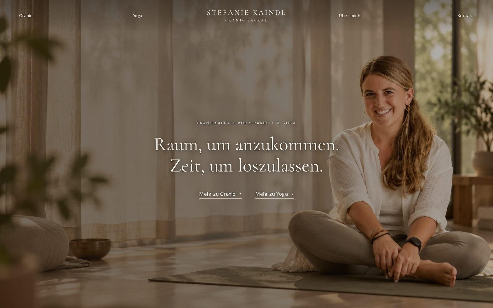
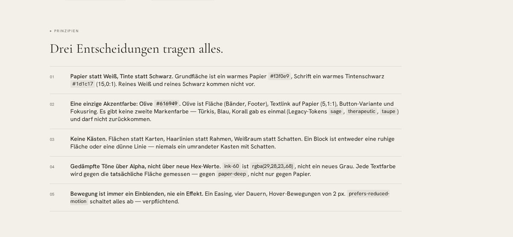
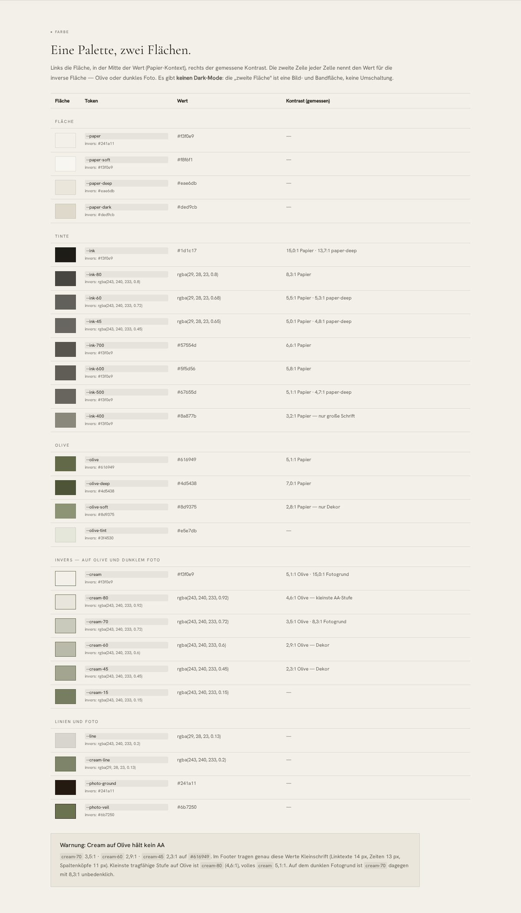
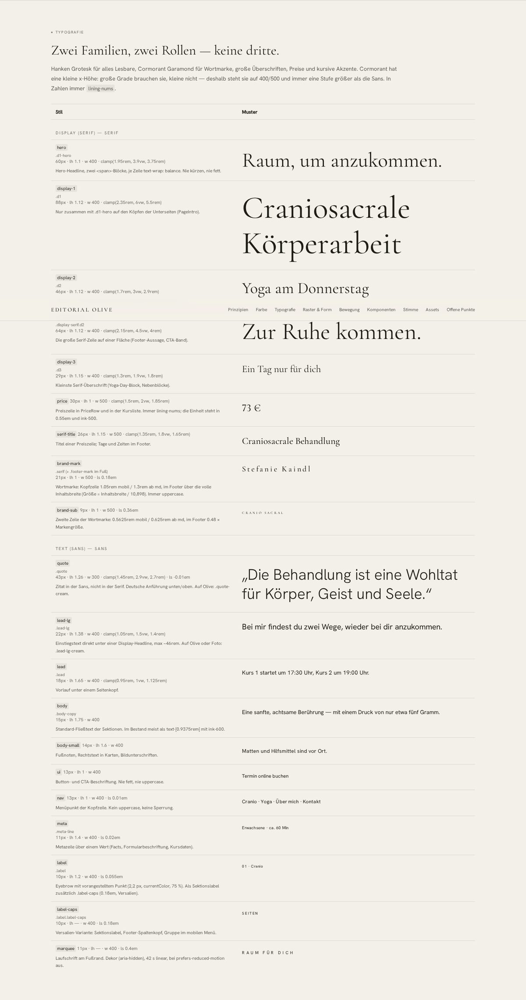
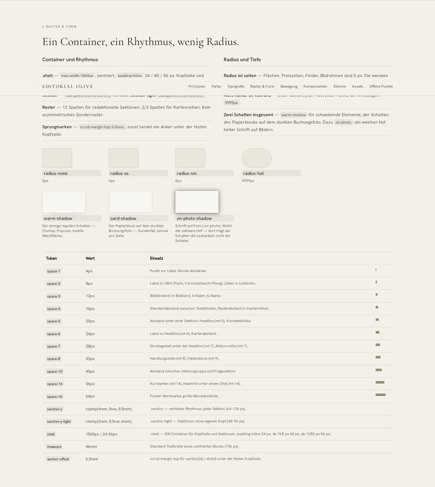
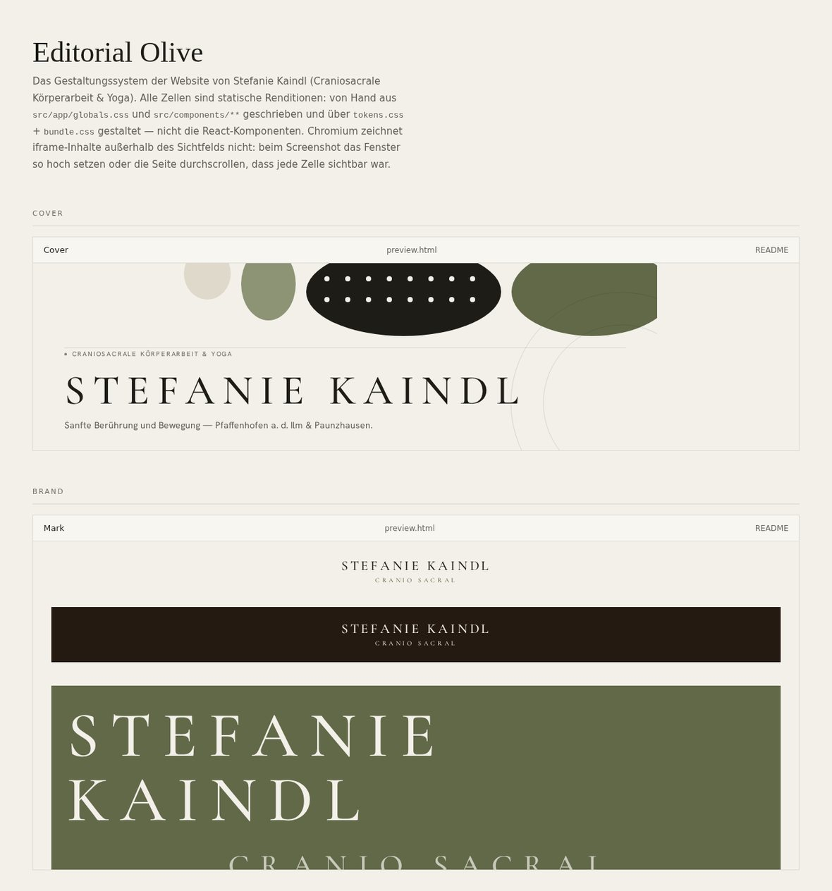
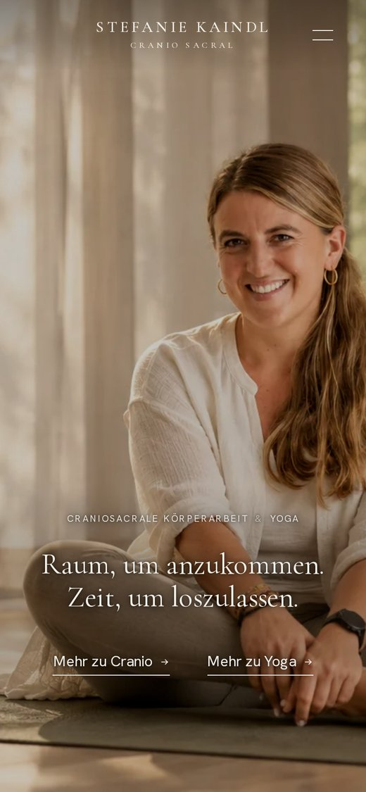
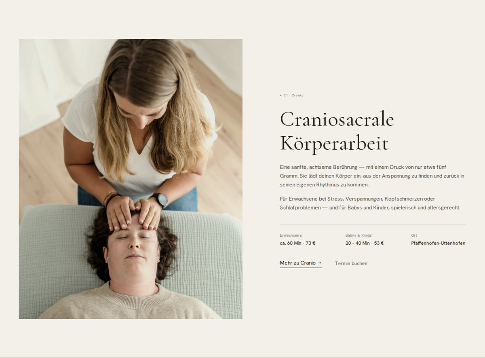
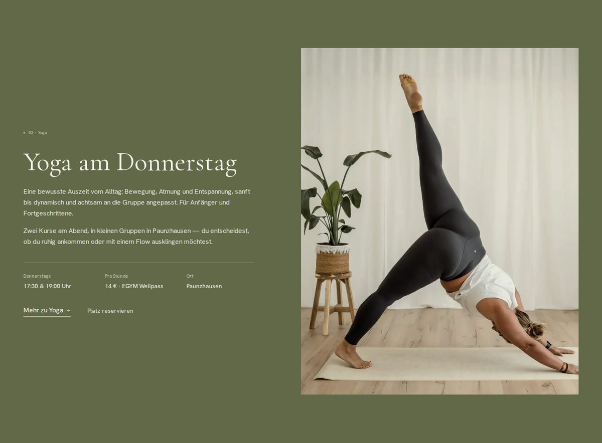
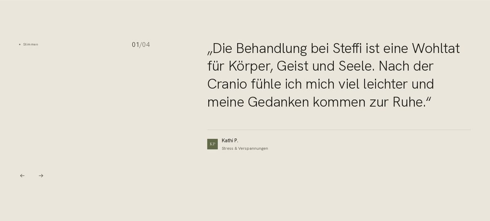

# Stefanie Kaindl — Cranio Sacral & Yoga



Website for Stefanie Kaindl: **craniosacral bodywork** and **yoga** in Pfaffenhofen an der
Ilm (Uttenhofen) and Paunzhausen. Two equal offers — Cranio and Yoga — one person, one quiet
tone. The visitor is always addressed informally (**du**).

- **Live:** <https://stefanie-kaindl-cranio.de> — a static export served by **DigitalOcean
  App Platform**, behind **Cloudflare**.
- **Repo:** `ChristianLutzCL/stefanie-kaindl-cranio` (private). `main` is production;
  `redesign/editorial-olive` carries the redesign (not merged yet — production still serves
  the pre-redesign build).
- **Language:** German. No CMS, no database, no login — all content lives in the source.
- **Design:** the **"Editorial Olive"** design system — paper instead of white, ink instead
  of black, a single accent colour (olive). See [The design
  system](#the-design-system-editorial-olive).

## Stack

| Piece | What |
|---|---|
| Framework | **Next.js 16** (App Router, Turbopack) with `output: 'export'` and `trailingSlash: true` |
| UI | **React 19**, **TypeScript 5.9** (`strict`) |
| Styling | **Tailwind CSS 3** (`tailwind.config.ts`) plus hand-written CSS in `src/app/globals.css` |
| Fonts | `next/font/google`: **Hanken Grotesk** (everything readable) and **Cormorant Garamond** (wordmark, quotes, prices) |
| Lint/format | **ESLint 9** (flat config, `eslint-config-next` + `eslint-config-prettier`), **Prettier** with `prettier-plugin-tailwindcss` |
| Hosting | DigitalOcean App Platform (static site, branch `main`, output `out/`), Cloudflare in front |
| Analytics | Google Analytics 4 (`G-CV0R2VE8F2`) with Consent Mode, consent collected by the cookie banner |

No test framework, no CI. The bar is `npm run lint` plus `npm run build`. The workflow in
`.github/workflows/nextjs.yml` comes from the starter template, targets a `live-demo` branch
and GitHub Pages, and is **not** used.

`next.config.mjs` additionally sets `allowedDevOrigins` for the review domain — without it
Next refuses to serve its own dev resources when the page is opened through the proxy.

## Quick start

Node **≥ 20.9** (the dev environment runs on `node:24-alpine`).

```bash
npm install
npm run dev            # Next dev on :3000
npm run lint           # eslint . (also covers scripts/ and the configs)
npm run build          # next build && node scripts/prune-disabled-routes.mjs
```

`npm run start` (`next start`) is leftover template weight and **does not work**: Next aborts
with `output: 'export'`. To inspect the export locally:

```bash
npm run build && npx serve out
```

`npm run build` writes the static export to `out/` and then removes the switched-off routes
(`scripts/prune-disabled-routes.mjs`, see [Routes](#routes)).

## Project structure

```
src/
  app/
    layout.tsx            root layout: fonts, metadata, navbar/footer, cookie banner, GA4
    page.tsx              homepage (hero + content)
    hero.tsx              hero with photo, eyebrow, two-line headline, CTAs
    content.tsx           homepage sections (intro, image band, cranio, yoga, approach,
                          about, voices, booking)
    globals.css           every design token + the system's class vocabulary (the truth)
    cranio/  yoga/        the two offer pages
    ueber-mich/  kontakt/ subpages; kontakt/content.tsx holds the form (n8n webhook)
    impressum/  datenschutz/  cookie-einstellungen/   legal pages + consent management
    angebote-preise/      redirect to /cranio/ (meta refresh, noindex)
    retreat/              Golden Summer Retreat — switched off, see src/site-config.ts
    _api/                 unrouted server endpoints (private folder) — see src/app/_api/README.md
    robots.ts             generates /robots.txt
    not-found.tsx         404 page in the Editorial Olive system
  components/
    navbar.tsx footer.tsx cookie-banner.tsx legal.tsx layout.tsx icons.tsx
    editorial.tsx         system building blocks: Photo, FlowerOfLife, SectionHead, PageIntro,
                          PriceRow, useReveal(), CONTACT, BOOKING
  site-config.ts          feature switches (RETREAT_ENABLED)
  lib/                    cookies.ts (consent), notion.ts
scripts/
  prune-disabled-routes.mjs   removes switched-off routes from out/
  build-event-card-image.mjs  turns an event flyer into a card-safe webp (blurred padding,
                              so object-cover only ever trims the edge)
public/
  image/                  photos (hero, treatment, yoga, rooms, portrait)
  logos/  favicon.ico  favicon.png  apple-touch-icon.png
  sitemap.xml             static sitemap (deliberately not app/sitemap.ts)
research/
  design-brief-editorial-olive.md   the reference and device analysis behind the redesign
  qa-check-2026-10-15.md            QA run: console errors, contrast, layout
docs/design-styleguide.html   one-page styleguide
docs/img/                     the images this README embeds
design-system/                design-system bundle (tokens, 18 component renditions, assets)
DESIGN.md                     the full specification of the system
design.tokens.json            tokens in DTCG format (export)
design.tokens.tailwind.json   tokens as a Tailwind `theme.extend` (export)
```

## Routes

| Route | What |
|---|---|
| `/` | homepage: hero, intro, a look inside the rooms, cranio, yoga, approach, about, voices, booking |
| `/cranio/` | the Cranio offer: process, audiences, prices, booking (Calendly) |
| `/yoga/` | the yoga offer: Thursday classes, times, prices, sign-up via WhatsApp |
| `/ueber-mich/` | the person, training, approach |
| `/kontakt/` | contact, address, form (posts to an n8n webhook) |
| `/impressum/` · `/datenschutz/` | legal pages |
| `/cookie-einstellungen/` | consent management (localStorage key `cookiePreferences`) |
| `/angebote-preise/` | redirect to `/cranio/` (meta refresh + links, `noindex, follow`) |
| `/retreat/` | Golden Summer Retreat — switched off via `RETREAT_ENABLED = false`: 404 in production, and neither the nav entry nor the teasers render. All the code stays in the repo (page, Stripe checkout, images). |
| `/robots.txt` | generated from `src/app/robots.ts`; `/api/` and `/cookie-einstellungen/` are excluded |
| `/sitemap.xml` | the static file `public/sitemap.xml` — in export mode `app/sitemap.ts` answers 500 under `next dev` |

A switched-off retreat is not just a `notFound()`: the export still writes an
`out/retreat/index.html` holding an empty Next error shell, and a static host serves that
with **200**. `scripts/prune-disabled-routes.mjs` therefore deletes the folder after the
build, so the host answers with its own 404.

The two endpoints in `src/app/_api/` (`retreat-checkout`, `yoga-dates`) are deliberately not
routed: they need a Node runtime, which a static export does not have.

## The design system, "Editorial Olive"

Three decisions carry the whole system:

1. **Paper instead of white, ink instead of black** — ground `#f3f0e9`, type `#1d1c17`.
2. **A single accent colour: olive `#616949`** — surface (bands, footer, price cards), text
   link on paper (5.1:1), a button variant, the focus ring. There is no second brand colour.
3. **No boxes** — surfaces instead of cards, 1 px hairlines instead of borders, whitespace
   instead of shadows. Hierarchy comes from surface → olive → dark photo.

The tone is quiet: large serif headlines at a low weight, plenty of air, motion only as a
fade-in. There is **no dark mode** — the "second surface" is olive or the photo, not a theme
switch.

### Visual overview

The screenshots below are the real artefacts, not mock-ups: they are sections of
`design-system/overview.html`, the visual one-pager that ships with the bundle.



*The three decisions, and what "one palette, two surfaces" means. Section `#prinzipien`.*



*Every token with its hex value, its role and its **measured** contrast — plus the warning
that cream on olive does not hold AA. Section `#farbe`.*



*Two families, two roles, one scale — hero to label, with the weights and sizes as they are
in `globals.css`. Section `#typografie`.*



*One container, one rhythm, little radius. Section `#raster`.*



*The [component board](design-system/components/index.html) — 18 renditions, each with its
own `preview.html` and a `README.md` stating the contract.*

### Where the system lives

| File | Role |
|---|---|
| `src/app/globals.css` + `tailwind.config.ts` | **normative** — what the site actually uses |
| `DESIGN.md` | the full specification (colour, type, layout, do's and don'ts) |
| `design-system/overview.html` | the visual one-pager the screenshots above come from |
| `design-system/README.md` | bundle description: contents, voice, how to apply it, open points |
| `design-system/tokens.css` · `tokens.json` | drop-in tokens, and machine-readable tokens (32 colours × two surfaces, 20 type styles, **measured contrast** per role) |
| `design-system/components/` | 18 renditions (`preview.html` + `README.md`), board at `components/index.html` |
| `docs/design-styleguide.html` | a one-page styleguide to show the client |
| `design.tokens.json` · `design.tokens.tailwind.json` | DTCG and Tailwind exports of the tokens (repo root) |

The bundle is **derived from** the codebase, not designed alongside it: it describes
`globals.css` and `tailwind.config.ts`, it does not replace them. Anyone building a page uses
the classes in the repo.

### Tokens

| Role | Value | Used for |
|---|---|---|
| `--paper` | `#f3f0e9` | the ground (`body`) |
| `--paper-soft` | `#f8f6f1` | lightened surface, cards |
| `--paper-deep` | `#eae6db` | quote band, form section, image ground |
| `--paper-dark` | `#ded9cb` | darkest paper step, image placeholder |
| `--ink` | `#1d1c17` | headlines, primary text (15:1) |
| `--ink-80` | `rgba(29,28,23,.8)` | 8.3:1 — not the hex value in the older design doc |
| `--ink-60` | `rgba(29,28,23,.68)` | body and secondary text (5.3:1 on `paper-deep`) |
| `--ink-45` | `rgba(29,28,23,.65)` | meta lines, placeholders (5.0:1) |
| `ink-400` | `#8a877b` | **large text only** (3.15:1) |
| `--olive` | `#616949` | the one accent colour |
| `--olive-deep` | `#4d5438` | hover target only |
| `--olive-soft` | `#8d9375` | decoration only (arcs, dots) |
| `--cream` | `#f3f0e9` | text on olive / dark photo (5.1:1) |
| `--cream-80` | `rgba(243,240,233,.92)` | smallest step that holds AA on olive (4.6:1) |
| `--cream-70` / `--cream-60` / `--cream-45` | `.72` / `.6` / `.45` | below AA on olive — dark photos and decoration only |
| `--line` / `--cream-line` | `rgba(29,28,23,.13)` / `rgba(243,240,233,.2)` | 1 px hairlines, always horizontal |

Muted tones are made **by alpha on `ink` or `cream`** — never by inventing hex values.
Tailwind's legacy names `cream`, `sage`, `taupe` and `therapeutic` still exist, retuned onto
paper/ink/olive so that pages not yet rebuilt appear in the new tone without touching every
class; new code uses `paper`, `ink`, `olive`.

### Typography

Two families, two roles, never a third:

- **Hanken Grotesk** (300/400/500 + italic) — everything readable.
- **Cormorant Garamond** (300–600 + italic) — wordmark, section and card headlines, quotes,
  prices, CTA and footer lines, italic accents. It is fine-stroked with a small x-height:
  large sizes need it, small text does not — hence weights 400/500 and always one step
  larger than the sans. Numbers always get `lining-nums` (Cormorant otherwise sets old-style
  figures).

| Role | Class | Size |
|---|---|---|
| Hero | `.d1-hero` | `clamp(1.95rem, 3.9vw, 3.75rem)`, serif 400 |
| Subpage hero | `.d1-hero.d1` | `clamp(2.35rem, 6vw, 5.5rem)` |
| Section | `.d2` | `clamp(1.7rem, 3vw, 2.9rem)` |
| Card | `.d3` | `clamp(1.3rem, 1.9vw, 1.8rem)` |
| Quote | `.quote` | `clamp(1.45rem, 2.9vw, 2.7rem)`, sans 300 |
| Lead-in | `.lead-lg` | `clamp(1.05rem, 1.5vw, 1.4rem)` |
| Lead / body | `.lead` / `.body-copy` | `clamp(0.95rem, 1vw, 1.125rem)` / `0.9375rem` |
| Meta / label | `.meta-line` / `.label` | `0.6875rem` / `0.625rem` |

### Class vocabulary

Layout: `.shell` (one container for everything, `max-width: 1560px`), `.section`,
`.section-tight`, `.hairline`, `.hairline-inverse`.
Text: `.display`, `.display-serif`, `.d1`–`.d3`, `.lead`, `.lead-lg`, `.body-copy`,
`.meta-line`, `.label`, `.label-caps`, `.label-inverse`, `.pill`, `.quote`, `.initials`,
`.accent`.
Actions: `.cta-link` (underline drawn with `border-bottom`, thickening on hover via
`box-shadow`), `.cta-link-ink`, `.arrow-link`, `.btn` + `.btn-ink` / `.btn-olive` /
`.btn-cream` / `.btn-outline-ink` / `.btn-outline-cream` / `.btn-block`.
Form/photo: `.field` (a single bottom line, focus turns it olive), `.ph` + `.ph-deep` (the
warm photo tone, applied with `filter`), `.on-photo` (soft halo behind type on photos).
Navigation/hero: `.nav-clear`, `.nav-solid`, `.nav-link`, `.hero-photo`, `.hero-scrim`,
`.hero-text-band`, `.footer-mark` / `.footer-mark-sub`, `.marquee`, `.arcs`.
Motion: `[data-reveal]` + `useReveal()` (900 ms, 16 px offset), `.hero-in-1..3`,
`.warm-shadow`.

### Rules that cost time

1. **Muted greys have to hold 4.5:1 on `paper-deep`**, not just on paper: that is why
   `--ink-45` is 0.65 and `--ink-60` is 0.68 alpha. `ink-400` is deliberately lighter and is
   for **large** text only.
2. **Unlayered CSS beats Tailwind utilities.** `.lead-lg`, `.quote` and `.display-serif` set
   `color` or `font-family` themselves — a `text-[var(--cream-80)]` on the same element does
   nothing. That is what `.lead-lg-cream` and `.quote-cream` are for.
3. **Cream on olive is the contrast trap.** `cream-70` (3.5:1) and below carry small text in
   the footer — an open point in the codebase, not a pattern to copy.
4. **Icons are arrows only** (`src/components/icons.tsx`, `0.68em`, scaling with the type,
   `stroke-width 1.25`). No icon sets, no emoji, no filled icons.
5. **`prefers-reduced-motion: reduce` switches off every animation, the marquee and all
   reveals** — mandatory, not optional.
6. **Radius is rare:** surfaces, fields and image frames are 0 px; the few real cards take
   6–8 px; everything round is fully round (`9999px`). There is exactly one shadow
   (`.warm-shadow`) plus `.on-photo`.

### The mobile hero

The hero text block is bottom-anchored so it can never cross the face — with `cover` on a
narrow viewport the photo scales to the viewport height, so the face always sits at the same
fraction of it. There is no flat veil over the photo: the scrim is a feathered band behind
the text only (`.hero-text-band`), peak opacity 0.2, and legibility is carried by the
inherited `text-shadow` on `.on-photo`.



## The system in use



*`#cranio` — paper surface, a 12-column editorial grid, hairlines carrying the price row.*



*`#yoga` — the olive band, the second surface, cream type, the same photo treatment.*



*`Stimmen` — the quote block on `paper-deep`, counter on the quarter line.*

## Content and wording

Client-confirmed rules — they apply to every text change:

- **Always address the visitor as `du`.** `Sie` appears only in the legal texts (Impressum,
  Datenschutz, Cookie-Einstellungen), where it belongs.
- **Never write "Praxis"** — it is not a practice. Allowed: "Adresse", "Seiten",
  "Behandlungsraum", "Einblicke in die Räume", "Über mich & Kontakt".
- **"Hausbesuche" is not an offer** and appears nowhere. The offers, as the footer lists them:
  Cranio für Erwachsene · Cranio-Intensiv · Cranio für Babys & Kinder ·
  Fußreflexzonenmassage · Yoga am Donnerstag. **No package, no Erstberatung** — the client had
  both removed in October 2026.
- **Wordmark: "Cranio Sacral".** Spelled out, the offer is "Craniosacrale Körperarbeit". The
  wordmark is typeset (Cormorant 500, 0.18em tracking), not an image file.
- **No exclamation marks, no emoji, no advertising adjectives.** Headlines are short
  statements ending in a full stop.
- **Numbers come from her material only:** Cranio für Erwachsene 73 € (ca. 60 min), Cranio-Intensiv
  100 € (90 min), Babys & Kinder 53 € (20–40 min), Fußreflexzonenmassage mit kurzer Cranio 50 €
  (ca. 40 min); yoga Thu 17:30 & 19:00 in Paunzhausen, 14 €/h, EGYM Wellpass. No invented prices,
  dates or testimonials. The price list mirrors her Calendly event types one to one.
- **Contact:** 0176 63094476 · info@stefanie-kaindl-cranio.de · Bahnstraße 2a, 85276
  Pfaffenhofen a. d. Ilm, Ortsteil Uttenhofen.
- **Booking:** Calendly `stefanie-kaindl-cranio` (`/cranio_session`, `/cranio-kinder`); yoga
  sign-up via WhatsApp (`wa.me/4917663094476`) with a prefilled message.
- **Contact form:** posts to the n8n webhook in `src/app/kontakt/content.tsx`. When testing,
  intercept the route (`page.route('**/n8n**')`) so no real message leaves.
- **Legal pages:** restyle the wording, **never rewrite it**. The privacy policy names
  DigitalOcean, Cloudflare and Google Analytics; report gaps to the client instead of filling
  them in yourself.

## Deployment

**Production** runs on **DigitalOcean App Platform** as a static site, configured in
`.do/app.yaml`:

- repo `ChristianLutzCL/stefanie-kaindl-cranio`, branch `main`, `deploy_on_push: true`
- build `npm run build`, output `out/`, `catchall_document: index.html`,
  `error_document: 404.html`
- **Cloudflare** in front (response headers `x-do-app-origin`, `x-do-orig-status`, `__cf_bm`)

So: pushing to `main` deploys. This machine is not production — unlike `chrislutz.me` (Vercel)
and the SenseCollect projects. If you need to know where something runs, read the response
headers before writing anything about hosting into a legal page.

**State of production** (checked on 17 Oct 2026): the last deploy is from 14 Oct 2026 and is
older than the branch. Live is still missing `/cranio/`, `/robots.txt` and `/sitemap.xml`
entirely (all three answer 404), the navigation there says "Angebote & Preise" instead of
"Cranio", and the homepage still carries the old design (`theme-color #67B1B1`, teal buttons,
`font-inter`). What sits in `out/` is therefore **not** live automatically: `main` (or the
redesign branch) has to be pushed and merged first.

**Review environment** (branch `redesign/editorial-olive`):

```bash
devsite up stefanie-kaindl-cranio      # https://dev-stefanie-kaindl-cranio.hub.chrislutz.me
devsite restart stefanie-kaindl-cranio
devsite down stefanie-kaindl-cranio
```

The domain sits behind the hub gate and is routed by Traefik to `:3000` in the
`dev-stefanie-kaindl-cranio` container (`/opt/dev/stefanie-kaindl-cranio/docker-compose.yml`).

**Build in the dev container** (when the dev server should not be running):

```bash
devsite down stefanie-kaindl-cranio
docker run --rm \
  -v /opt/sites/stefanie-kaindl-cranio:/app \
  -v dev-stefanie-kaindl-cranio_node_modules:/app/node_modules \
  -w /app node:24-alpine sh -lc "rm -rf .next out && npm run build"
devsite up stefanie-kaindl-cranio
```

**Never run two builds at once.** A second build, or a dev server compiling into the same
`.next`, produces a one-off, non-reproducible `Failed to compile.`

## Open points

Measured, not guessed — documented in the bundle and in `DESIGN.md`:

1. **Cream on olive does not hold AA:** `cream-70` 3.5:1, `cream-60` 2.9:1, `cream-45` 2.3:1
   on `#616949`. In the footer they carry 11–14 px text (link text, times, column heads),
   plus `.label-inverse` (10 px) and the marquee. The smallest workable step is `cream-80`.
2. **Favicon, Apple-Touch icon and `public/logos/*` are still teal** (`#9dcdcd` / `#67b1b1`)
   — the pre-redesign state. Both ways forward are described in
   `design-system/assets/Logos/README.md`.
3. **`/retreat`** still uses cards with white surfaces, `rounded-lg` and shadows — not the
   system. The page is switched off and removed at build time; the 404 page has already been
   converted.
4. **The legacy tokens** `cream`, `sage`, `taupe` and `therapeutic` in `tailwind.config.ts`
   are compatibility, not part of the palette.
5. **The design-system bundle is new and not committed yet** (`DESIGN.md`, `docs/`,
   `design-system/` and `design.tokens*.json` are untracked in the working tree).

## Origin and licence

The repository started as the Creative Tim template *"Next.js Tailwind Blog Post Details
Page"* (remote `upstream`, GitHub Pages workflow, `CHANGELOG.md`, `ISSUE_TEMPLATE.md`, MIT
licence with Creative Tim's copyright). Practically nothing of the template is still in use:
pages, content and design have been rewritten from scratch. `@material-tailwind/react` is
only needed for the `withMT()` wrapper in `tailwind.config.ts` — nothing imports its
components. Do **not** remove that wrapper: `withMT` also swaps Tailwind's default palette in
(preflight border `#eee` instead of `#e5e7eb`), and the design depends on it.
